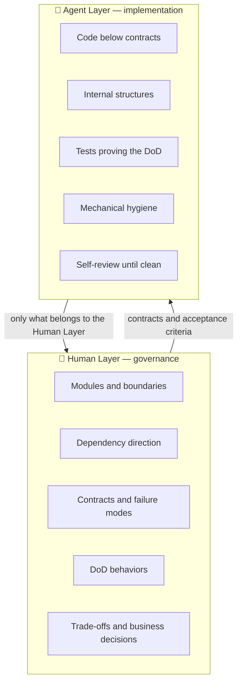
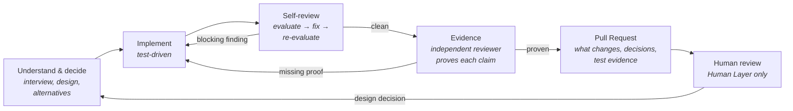

# ai-skills ✨

A curated, public distillation of my approach to AI-assisted software engineering. Packaged as universal **skills** installed from a single source across **Claude Code**, **Codex**, **Antigravity CLI**, and **Cursor CLI**.

This project shares an opinionated baseline for AI pair programming: assigning what is expensive to get wrong to the human (architecture, contracts, boundaries) and what is expensive to read to the agent (mechanics, test suites, self-review).


## 🧭 The Problem

An agent writes code faster than any human can read. Reviewing everything line-by-line turns the human into a bottleneck; reviewing nothing turns software into a pile of decisions no one actually made: an architectural tangle of well-intentioned but short-sighted choices.


## 🧱 Two Layers



| | 👤 Human Layer | 🤖 Agent Layer |
| :--- | :--- | :--- |
| **Decides** | Which modules exist, what each promises, where dependencies point, what defines "done". | How each module fulfills its promises. |
| **Reviews** | The plan of what is new and where it lives, contracts, the behavior table, and the evidence that the delivered commit does what was asked—never the entire diff. | Its own code, in an automated loop, before any human sees it. |
| **Receives from the other side** | Only what belongs to its layer: pending decisions, new contracts, manual verifications, and the evidence for each claim. | Clear contracts and acceptance criteria. |

**The boundary test**, whenever it is unclear who owns a decision:

> *Would changing this require renegotiating a contract with external callers, or can it be rewritten tomorrow without anyone outside the module noticing?*
> Renegotiate → 👤 human. Silently rewrite → 🤖 agent.


## 🔁 The Delivery Cycle



- **Before coding**, high-consequence decisions pass through the human. When a decision carries heavy weight, the agent designs **twice**, exploring radically different alternatives, and brings a recommendation instead of a single path.
- **During**, the agent writes tests first whenever an observable behavior and a way to test it exist.
- **Before the human**, the agent reviews itself with an iteration budget and limit: fixes blocking issues, fixes anything with a concrete failure scenario, discards style preferences, and **escalates** anything that would touch a contract.
- **Before review**, the delivery carries its evidence: each claim (behavior covered, tests passing, nothing new left unlisted, no rule or test weakened) comes with a proof the human can open or re-run, for the exact commit being delivered. A reviewer with a clean context, not the agent that wrote the code, checks it. A claim without proof counts as not done.
- **In review**, the human evaluates what was built against what was requested, in diagrams, a behavior table, and that evidence, rather than wading through a sea of lines.

I use the same lenses for collaborating on other people's work: reviewing a peer's PR, responding to received reviews, and resolving conflicts between parallel branches without discarding either work.


## 📚 The Theories Behind It

Design and code judgments cite a named concept from the books in the table below. A finding reads "this is a shallow module", not "I would have done it differently".

| Source | What was adopted | Where it appears |
| :--- | :--- | :--- |
| **John Ousterhout**, *A Philosophy of Software Design* | Complexity as the central enemy (dependencies and obscurity). **Deep modules**: small interface, rich implementation. Information hiding and leakage. Pulling complexity downwards. Defining errors out of existence. Different layer, different abstraction. **Strategic** rather than tactical programming. **Design it twice**. Comments that explain why. | All software design and architecture review. |
| **Robert C. Martin**, *Clean Architecture* | The dependency rule: **dependencies point toward business rules**; policy never depends on databases, frameworks, or external providers. | Dependency direction, on the Human Layer. |
| **Martin Fowler**, *Refactoring* | The catalog of **code smells** and named refactorings, in small steps, always with green tests, never mixed with behavioral changes. | Code quality below contracts. |
| **Kent Beck**, *Test-Driven Development* | **Red → green → refactor.** A test that has never failed proves nothing. | Implementation. |
| **Classical Testing School** (Vladimir Khorikov, *Unit Testing Principles, Practices, and Patterns*) | The unit of testing is an **observable behavior via public interface**. Internal collaborators run for real; test doubles only for things outside process control (network, system clock, LLMs). A test that breaks upon refactoring is a bad test. | Testing and test review. |

Where schools diverge, I state my position. For instance: between the tiny functions of *Clean Code* and the deep, cohesive functions of Ousterhout, my rule is to extract **when the extracted piece is independent**, avoiding extractions that merely scatter what should be read together.

### Agents in parallel

More agents are not more throughput. The rules for running agents in parallel come from studies of multi-agent systems and from how practitioners run coding agents today; the full reasoning is in [`agentic-parallel-work`](skills/agentic-parallel-work/references/studies-and-practices.md).

| Source | What was adopted | Where it appears |
| :--- | :--- | :--- |
| **Anthropic**, [*How we built our multi-agent research system*](https://www.anthropic.com/engineering/built-multi-agent-research-system) | Agents cost about 4× the tokens of a chat and multi-agent systems about 15×; they pay off on breadth-first work with independent parts, not on tightly interdependent work. **Parallelize only what is independent.** | Splitting work, `agentic-parallel-work`. |
| **Google Research and MIT**, [*Towards a Science of Scaling Agent Systems*](https://arxiv.org/abs/2512.08296v3) | Multi-agent setups gained up to +80.8% on a decomposable task and lost up to −70% on sequential planning: **the architecture must match the task**. Its thresholds were revised between versions, so they are evidence, not laws. | One session per delivery; sequential work stays in one session. |
| **UC Berkeley**, [*Why Do Multi-Agent LLM Systems Fail?*](https://arxiv.org/abs/2503.13657) (MAST) | About a third of multi-agent failures are **misalignment between agents**. | No conversation between agents. |
| **Cognition**, [*Don't Build Multi-Agents*](https://cognition.ai/blog/dont-build-multi-agents) and [*Multi-Agents: What's Actually Working*](https://cognition.com/blog/multi-agents-working) | Parallel writers make conflicting implicit decisions: **single-threaded writes**, helpers that contribute intelligence, and a **clean-context reviewer**. | One writer per delivery; subagents answer once; the independent reviewer of `provide-evidence`. |
| **Practitioners and tools**: [Simon Willison](https://simonwillison.net/2025/Oct/5/parallel-coding-agents/), [Addy Osmani](https://addyosmani.com/blog/future-agentic-coding/), [Conductor](https://www.conductor.build/docs/concepts/git-worktrees), [Cursor](https://cursor.com/docs/configuration/worktrees) and [Codex](https://developers.openai.com/codex/app/worktrees) worktrees, Claude Code [agent teams](https://code.claude.com/docs/en/agent-teams) | **One worktree per agent**, the human reviewing deliveries instead of transcripts, and a few agents in flight because **review capacity is the limit**. | Branches and worktrees, the in-flight limit. |

### Reading for the reader

| Source | What was adopted | Where it appears |
| :--- | :--- | :--- |
| **BLUF** (bottom line up front), from military writing; [Matt Ström-Awn, *Bottom Line Up Front: write to make decisions faster*](https://mattstromawn.com/writing/bluf/) | The first sentence says what the reader must know, decide, or do, as a concrete action, not a description of the text. The criterion is relevance to the reader, not compression. | `tl-dr` digests, `coordinator`, `brainstorm` syntheses. |
| **Bryan A. Garner**, [*Should the bottom line be up front? Only with context*](https://www.abajournal.com/columns/article/should-the-bottom-line-be-up-front-only-with-context-says-bryan-garner) (ABA Journal) | A bottom line without one line of context skips the delicate part: **add the condition or risk that would change the action**. | The context line of a `tl-dr` digest. |


## 🧩 What the Skills Have in Common

- **The agent proposes, the human decides.** Nothing goes out to the world (push, comment, issue, message) without explicit confirmation.
- **Facts are the agent's job; decisions belong to the human.** The agent doesn't ask what it can discover on its own, and doesn't answer its own decision questions.
- **Done means proven.** An agent's work is accepted on evidence, not on its own report: every claim points to a proof the human can open or re-run, for the exact commit delivered, checked by a reviewer that did not write the code ([`provide-evidence`](skills/provide-evidence/SKILL.md)).
- **Findings require concrete failure scenarios.** Judgment without a probable bug, an expensive change, or real reader confusion is preference, and preference does not become a finding.
- **Show before describing.** What a change adds and where it lives reads as a plan, one line per thing; how a flow works reads as swimlanes.
- **A pull request documents the change, never the work.** It is written for the developers who review it and read it later: why, what changes and where, the decisions, and the test evidence. No workflow reads state from it; the work's state lives in the session, the issue, or local git notes.
- **Nothing the reader cannot open.** Commits, PRs, and comments never reference local machine paths.
- **Human writing.** Text meant for human teammates undergoes review against formulaic AI writing habits.
- **Every skill specifies how to verify success.**

The current catalog is in [`skills/`](skills/). It evolves over time; the philosophy above is what remains.

## 🙏 Credits

Some skills are ported from external references, credited below.

| Skill | Reference | Original | What changed |
| :--- | :--- | :--- | :--- |
| `design-patterns` | [Refactoring Guru](https://refactoring.guru) | [Design Patterns catalog](https://refactoring.guru/design-patterns/catalog) | **Transposition & Adaptation.** Classic patterns catalog transcribed to native on-demand skill format, filtered strictly through the Law of Parsimony and modern language idioms. |
| `grill-me` | [Matt Pocock's skills](https://github.com/mattpocock/skills) | [`grilling`](https://github.com/mattpocock/skills/blob/main/skills/productivity/grilling/SKILL.md), [`grill-me`](https://github.com/mattpocock/skills/blob/main/skills/productivity/grill-me/SKILL.md) | **Transposition.** His two skills merged into one, in this repository's format. |
| `handoff` | [Matt Pocock's skills](https://github.com/mattpocock/skills) | [`handoff`](https://github.com/mattpocock/skills/blob/main/skills/productivity/handoff/SKILL.md) | **Transposition, plus additions:** when a handoff is justified, and verified facts kept apart from assumptions. |
| `improve-architecture` | [Matt Pocock’s skills](https://github.com/mattpocock/skills) | [Improve codebase architecture](https://www.aihero.dev/skills-improve-codebase-architecture) | **Inspiration.** Opportunity discovery uses this repository’s design principles, destination-aware visualization, and optional continuation into authorized implementation. |
| `interface-designing` | [Anthropic's skills](https://github.com/anthropics/skills) | [`frontend-design`](https://github.com/anthropics/skills/blob/main/skills/frontend-design/SKILL.md) | **Adaptation.** Its design craft becomes a reference, with an existing design system as the brief; adds flows to create a design system, refactor a whole application, and refactor a screen with before-and-after evidence. Apache 2.0; see the skill's `NOTICE.md`. |
| `prototype` | [Matt Pocock's skills](https://github.com/mattpocock/skills) | [`prototype`](https://github.com/mattpocock/skills/blob/main/skills/engineering/prototype/SKILL.md) | **Adaptation.** The UI branch builds a standalone mockup outside the repository, with the project's design system, instead of variants on an app route. |

Compared against upstream at the time of the port; later changes there are not tracked.


## 🔧 External Tools

Most skills need nothing beyond the harness. A few drive command-line tools, which must be installed and authenticated before those skills run. No skill depends on an MCP server.

| Tool | Used by | Required for |
| :--- | :--- | :--- |
| [Git](https://git-scm.com/) | `agentic-parallel-work`, `commit`, `coordinator`, `git-cleanup`, `pr-code-review`, `provide-evidence`, `report-work`, `resolve-branch-conflict` | Reading history and diffs, creating branches and commits. |
| [GitHub CLI](https://cli.github.com/) (`gh`) | `coordinator`, `git-cleanup`, `pr-code-review`, `pull-request`, `pr-review-react`, `provide-evidence`, `report-work`, `resolve-branch-conflict`, `tl-dr` | Reading and writing pull requests, reviews, and comments. Run `gh auth login` first. |
| [Herdr App](https://herdr.dev/) (`herdr-app` and `hc`) | `herdr`, used by `handoff`, `brainstorm`, `coordinator`, `tl-dr`, and `git-cleanup` (optional) | Opening tabs and spaces with an agent of any harness, reading the live state of agents, and noting which agents use a worktree before cleaning it. Requires the Herdr App (desktop app with herdr-core); the older Herdr terminal multiplexer (`herdr` CLI) is not supported. |
| Harness CLIs (`claude`, `codex`, `cursor-agent`, `agy`) | `brainstorm` (optional) | Asking other models headless; without them, `brainstorm` uses subagents. |
| [Playwright CLI](https://playwright.dev/docs/getting-started-cli) (`playwright-cli`) | `browser-test` | Driving a browser, headless by default, to test and verify web pages. Install with `npm install -g @playwright/cli@latest`, then `playwright-cli install-browser chromium`. |

Issue trackers (Jira, GitHub Issues, Linear) are mentioned only as places to reference or file work: the skills use whatever access the harness already has and never require a specific integration.


## 🚀 Installation

| Harness | Rules (SSOT) | Project skills | Global skills |
| :--- | :--- | :--- | :--- |
| **Claude Code** | `CLAUDE.md` → `AGENTS.md` | `.claude/skills/` | `~/.claude/skills/` |
| **Codex** | `AGENTS.md` | `.agents/skills/` | `~/.codex/skills/` |
| **Antigravity CLI** | `AGENTS.md` or `GEMINI.md` | `.agents/skills/` | `~/.gemini/config/skills/` |
| **Cursor CLI** | `AGENTS.md`; globally, a `sessionStart` hook in `~/.cursor/hooks.json` | `.cursor/skills/` or `.agents/skills/` | `~/.cursor/skills/` |

### Global (recommended)

```bash
./scripts/setup-global.sh
```

1. Detects which harnesses are installed on your machine (`claude`, `gemini`/`agy`, `codex`, `cursor`) and skips uninstalled ones automatically to avoid polluting your home directory with empty dotfiles (use `--all` to force installation for all harnesses).
2. Symlinks each skill from `skills/` into the global skills folder of each detected harness. Any real folder with the same name (legacy copy) is moved to `~/.ai-skills-backup/<timestamp>/` before the link is created, and dangling links to skills removed from the repo are pruned.
3. Prompts whether to link [`global/AGENTS.md`](global/AGENTS.md) as the global instruction across the detected harnesses (`~/.claude/CLAUDE.md`, `~/.codex/AGENTS.md`, `~/.gemini/GEMINI.md`, and `~/.gemini/config/AGENTS.md`). Existing files are moved to the same backup. Cursor CLI reads no global rules file, so setup instead adds a `sessionStart` hook to `~/.cursor/hooks.json` that injects the current `global/AGENTS.md` into every session, keeping any hooks already there (the original file is backed up first; needs `jq`). Use `--global-instructions` to link without prompting, or `--skills-only` to install only the skills.

[`global/AGENTS.md`](global/AGENTS.md) is what makes the workflow mandatory across any project: it specifies, by trigger, when to load each skill (for example, `coding` before editing any code file). The root [`AGENTS.md`](AGENTS.md) serves strictly to maintain this repository.

Because everything is symlinked, a `git pull` instantly updates skills and instructions across all harnesses. Re-run the script only when skills are added or removed.

#### Checking the harnesses

```bash
./scripts/check-harnesses.sh [--skill <name>]
```

Asks each installed harness CLI (`claude`, `codex`, `agy`, `cursor-agent`) one short headless question from an empty folder, and prints whether its context holds the global instructions and whether it sees a skill (`agentic-parallel-work` by default). It changes no configuration and costs one short model call per harness.

#### Uninstalling

```bash
./scripts/uninstall-global.sh
```

1. Removes what setup installed from this repository: in the global skill folders and the global instruction paths, links that point into the repo and identical copies (Git Bash on Windows copies instead of linking when it lacks symlink permission); in Cursor's `hooks.json`, only the hook setup added. Your own skills, links to other sources, and anything that differs from the repo are left untouched and reported.
2. Leaves `~/.ai-skills-backup/` alone and tells you it is there. Use `--restore` to move what setup replaced back to where it was. The most recent backup of each path wins, and a path already in use is never overwritten.

Use `--skills-only` to keep the global instructions, and `--dry-run` to see what would change without changing anything. Run it from the same clone that ran setup: links are recognized by where they point, and copies by matching its content.

### In a specific project

```bash
./scripts/link-project.sh /path/to/project
```

1. Creates a baseline `AGENTS.md` if one doesn't exist, and points `CLAUDE.md` and `GEMINI.md` to it.
2. Points `.claude/skills` and `.agents/skills` to `skills/`. If the project already has its own skills, they are preserved and skills from this repo are symlinked individually without overwriting homonyms.


## ✍️ Creating a Skill

The full standard is in [`AGENTS.md`](AGENTS.md), section 3. In summary:

```text
skills/<kebab-case-name>/
├── SKILL.md       # required: frontmatter (name, description) + instructions
├── references/    # in-depth guidance loaded on demand
├── scripts/       # executable utilities
└── resources/     # templates and assets
```

- The `description` states in 3rd person what the skill does and **when** it should be triggered.
- Keep `SKILL.md` lean; deep-dive material belongs in `references/`.
- Write and edit skill text with [`prompt-engineering`](skills/prompt-engineering/SKILL.md): a skill is a prompt.
- Skills and documentation are authored in English by default.
- Every skill ends with a **Success Validation** section.
- After creating, run `./scripts/setup-global.sh`.


## 🤝 Contributing

Contributions are welcome. See [`CONTRIBUTING.md`](CONTRIBUTING.md) for the workflow and the rules every change follows.


## 📄 License

This repository is licensed under the [Creative Commons Attribution-NonCommercial 4.0 International](LICENSE) (CC BY-NC 4.0) license. You are free to share and adapt the materials for non-commercial purposes with appropriate attribution.

