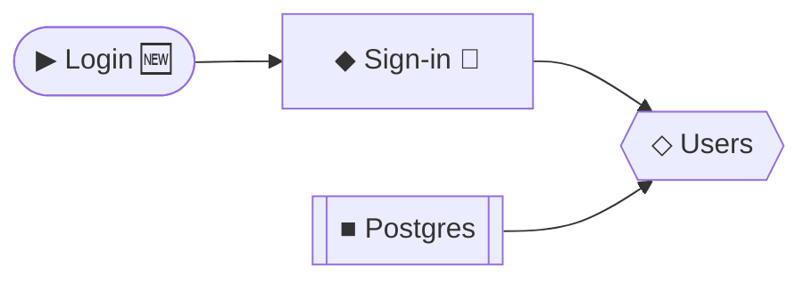

# GitHub Pull Request

Skill for structuring, documenting, and opening Pull Requests on GitHub.

---

## 1. Pull Request Principles

- **Designed for the Reviewer**: The reviewer must understand the purpose of the PR within the first 5 seconds of reading.
- **Focus on High-Level Review**: Grounded in the philosophy of [`ai-assisted-software-development`](../ai-assisted-software-development/SKILL.md) and [`human-review`](../human-review/SKILL.md). Do not clutter the PR with internal implementation minutiae already validated by [`agent-self-review`](../agent-self-review/SKILL.md).
- **Visuals via `visualize-it`**: a clean Mermaid module map shows boundaries and dependency direction; separate interface cards show what each component exposes and what changed.

---

## 2. Issue Linkage and Traceability

Link a tracking issue when one already exists in context. An issue is not required to open the PR.

### Agent Workflow:
1. **If an issue exists in context** (Jira, GitHub Issues, Linear, etc.):
   - Link the identifier and URL in the PR traceability section.
   - Link every issue the PR resolves, not only the main one.
2. **If no issue exists in context**: proceed without an issue link. Do not ask the user to create one.

### Supporting References

Beyond the issue, the traceability section records where the work came from and what it connects to, so any reader can follow the trail without asking:

| Reference | What it links |
| :--- | :--- |
| **Origin** | The report or discussion that started the work (user report, support thread, team conversation). |
| **Error** | The monitored error or alert the PR addresses. |
| **Related PRs** | Companion changes in other repositories or layers. |
| **Other** | Design docs, decision records, mockups, recordings, dashboards, or queries. |

- **Gather available links** from the conversation, branch, commits, and issue description or comments when accessible. Omit references whose links are unavailable; do not pause PR creation to request them.
- **Label every link** with what it is (e.g., `[support report on checkout failure](<url>)`), never a bare URL.
- **Include only lines that have a link**: omit empty categories instead of writing "N/A".
- Every link must be reachable by the reader ([no-local-references](../ai-assisted-software-development/references/no-local-references.md)).

---

## 3. PR Title Format

```text
Type/Concise Description
```
*Accepted Types:* `Feat/`, `Fix/`, `Refactor/`, `Chore/`, `Perf/`, `Docs/`.
*Examples:*
- `Feat/Refresh token authentication and key rotation`
- `Fix/Intermittent timeout on payment gateway call`
- `Refactor/Isolate order repository persistence`

> **Convention note**: PR titles use a PascalCase prefix followed by a description in the team/repository language for triage on GitHub, while individual commits strictly adhere to English Conventional Commits (`feat(auth): ...`).

---

## 4. PR Description Template (Body)

Use the structure below:

> **Body language**: all prose and section headings in the description, plus the DoD table header and legend, use the team/repository language (same rule as the title). The template headings below are placeholders: translate them. Keep technical terms (`Definition of Done`, `breaking changes`) and code identifiers as is. Do not copy the language of previous PRs if it conflicts with this rule.

````markdown
## Summary
[In 1 or 2 direct sentences, explain what this PR does and why it exists from the reader's perspective. Be direct: what does the system do now that it did not do before?]

---

## Traceability & Issue
- **Issue**: [Link and issue key, e.g.: `#42` or `PROJ-123`] (short summary of the issue)
- **Origin**: [Labeled link to the report or discussion that started the work]
- **Error**: [Labeled link to the monitored error or alert]
- **Related PRs**: [Labeled links, e.g.: `#1235 (frontend)`]
- **Other**: [Labeled links to docs, decision records, mockups, recordings, dashboards]
<!-- Keep only the lines that have a link. Omit this section if there are no links. -->

---

## Decisions & Trade-offs
[When material, explain actual business rules/restrictions, consequential trade-offs, assumptions, and maintenance commitments introduced by the change. Derive this from the implementation and reuse existing human-review findings; do not run a separate review just to fill this section. Omit if there is nothing material.]

---

## Architecture & Contracts

<!-- Module map via visualize-it: friendly names, type symbols, unlabeled arrows, its classDef styles, and the legend line below -->

▶ entry · ◆ business rule · ◇ contract · ■ infra · arrow = depends on · 🆕 new · 🔧 modified · ⚠️ deviation

<One-paragraph reading of the map: what is new, and confirmation that dependencies keep pointing inward toward business rules ([dependency-direction.md](../software-designing/references/dependency-direction.md)), or the ⚠️ deviation.>

### Interface Cards
<!-- Cards for new/altered contracts and unchanged guarantees material to understanding the change, in the visualize-it interface card format. Explain changed guarantees or failure modes separately, keyed by interface/method; keep cards limited to the interface name and marked methods. -->

#### ◆ Sign-in 🔧
`SignInService` · 4 methods · 2 in scope

- 🔧 `signIn(email, password, device) → Session` · before: `signIn(email, password)`
- `refresh(token) → Session` · _used by this change_

<sub>Out of scope: `signOut` · `revokeAll`</sub>

---

## Delivered Behaviors (Definition of Done)

Status table mapping implemented behaviors to verification status, adhering to the legend from [`human-review`](../human-review/SKILL.md) (Verification and decision section):

| Status | Delivered Behavior | Verification | Action for Reviewer |
| :---: | :--- | :--- | :--- |
| ✅ | Reject expired tokens with HTTP 401 | Unit test in `tests/auth.test.ts` | None (covered by test) |
| 🔎 | Dispatch confirmation email via real provider | Not code-testable; verified in staging | Optional to test |
| 👤 | Responsive layout for login form | Requires visual inspection | Open `/login` and verify on mobile (375px) |

*Legend: ✅ Covered by automated test · 🔎 Not code-testable, verified via alternative means · 👤 Requires manual human validation · 🚨 Missing or unverified*

---

## Impact & Breaking Changes
- [Describe API contract breaks, database migrations, or new environment variables. If none, write "None"].
````

### Screenshot (Optional)

When the diff changes the user-facing presentation layer (screens, components, styles, layouts), add a `Screenshot` section with one embedded image if an accessible image URL is already available. Otherwise omit the section and mention after creating the PR that the developer may add a screenshot in GitHub. Do not pause to request one.

GitHub CLI and API cannot upload images into a PR body, so do not try to attach image files. Never commit images to the repository or upload them to third-party hosts just to embed them.

---

## 5. PR Creation Workflow

1. **Branch Self-Review**:
   - If the branch carries code authored by the agent pipeline, run [`agent-self-review`](../agent-self-review/SKILL.md) in **branch mode** (Section 3.2) unless `HEAD` already carries a `branch` self-review note. Resolve its Blocking findings before continuing; list its Escalate findings for the developer.
2. **Ensure Remote is Up to Date**:
   - Verify all commits are recorded and push the branch:
     ```bash
     git push -u origin <branch-name>
     ```
3. **Create the PR**:
   - Prepare and verify the title and body, then open the PR without a separate approval prompt or preview. The user's request to open the PR authorizes creation of the draft.
   - Run the command via GitHub CLI:
     ```bash
     gh pr create --draft --title "<title>" --body-file <body-file>
     ```
   - Create as `--draft` unless the user explicitly requests ready for review.
4. **Output**:
   - Return the clickable GitHub PR link.
   - For a visible UI change without an embedded screenshot, mention that the developer may add one through GitHub's web interface.

---

## 6. Success Validation

- [ ] Agent-authored branches passed `agent-self-review` in branch mode before the PR was opened.
- [ ] Existing issue links were verified; absence of an issue did not block PR creation.
- [ ] Supporting references found in context are listed with descriptive labels, with no empty categories.
- [ ] Title follows standardized format (`Type/Description`).
- [ ] Body includes direct summary, module map and interface cards (via `visualize-it`), and DoD table with official legend.
- [ ] Section headings, DoD table header, and legend are in the team/repository language, not the template's English.
- [ ] For a visible UI change, an available screenshot was embedded or the developer was reminded after creation that one can be added.
- [ ] PR was opened (defaulting to `--draft`) and clickable link returned.
