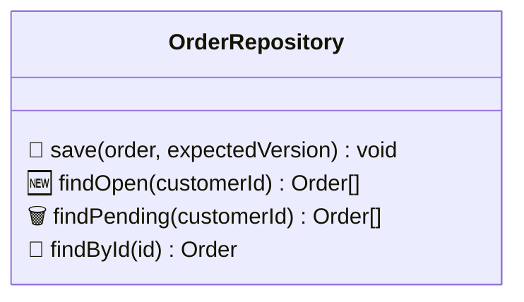

# Interface Cards

A card shows one public interface and the methods relevant to the change. Keep dependencies in the separate module map and connect views through the map's code-name index.

## 1. Scope and Content

- Include new or altered public interfaces and unchanged interfaces used by the change. Entry points and infrastructure adapters need a card only when they expose a new public interface.
- Read cards in map order: business rules first, then contracts.
- Show only the exact interface name and relevant method signatures. Omit friendly headings, interface sizes, previous signatures, out-of-scope methods, and explanatory notes.
- Order methods: 🔧 altered, 🆕 new, 🗑️ removed, 🔹 used without modification. Mark all methods on a new interface as 🆕. A removed method shows its last signature.
- Keep parameter names and a simplified return type after the closing parenthesis. Omit wrappers such as `Promise<…>` and full type paths. This is a visual summary, not compilable code; preserve types that are necessary to understand the contract.
- Share one short marker legend across cards. Translate legend labels into the reader's language; preserve code identifiers.

## 2. Terminal / Chat

Use a plain fenced code block without a language tag. No box borders, tables, bullets, or relationship arrows inside the card.

```
class OrderRepository {
  🔧 save(order, expectedVersion) void
  🆕 findOpen(customerId) Order[]
  🗑️ findPending(customerId) Order[]
  🔹 findById(id) Order
}
```

🔧 altered · 🆕 new · 🗑️ removed · 🔹 used without modification

## 3. PR / Mermaid-Rendering Documents

Use `classDiagram` with the same name, methods, ordering, and markers. Do not add notes, relationships, counts, or a second heading inside the diagram.



🔧 altered · 🆕 new · 🗑️ removed · 🔹 used without modification

## 4. Contract Decisions

Design workflows still need to establish observable promises, hidden knowledge, and failure modes. Reviews still need to surface changes to guarantees or errors. Explain those decisions in surrounding text or the workflow's decision section, naming the interface/method; they are not part of the card. Do not repeat unchanged contract documentation merely because a card exists.

## 5. Validation

- [ ] Each card contains only the interface code name and relevant signatures.
- [ ] Every method has a status marker, in canonical order, with one shared legend.
- [ ] Terminal uses a plain class-like block; rendered documents use Mermaid classDiagram.
- [ ] No dependency edges or detail notes appear in cards; required contract decisions remain outside them.
