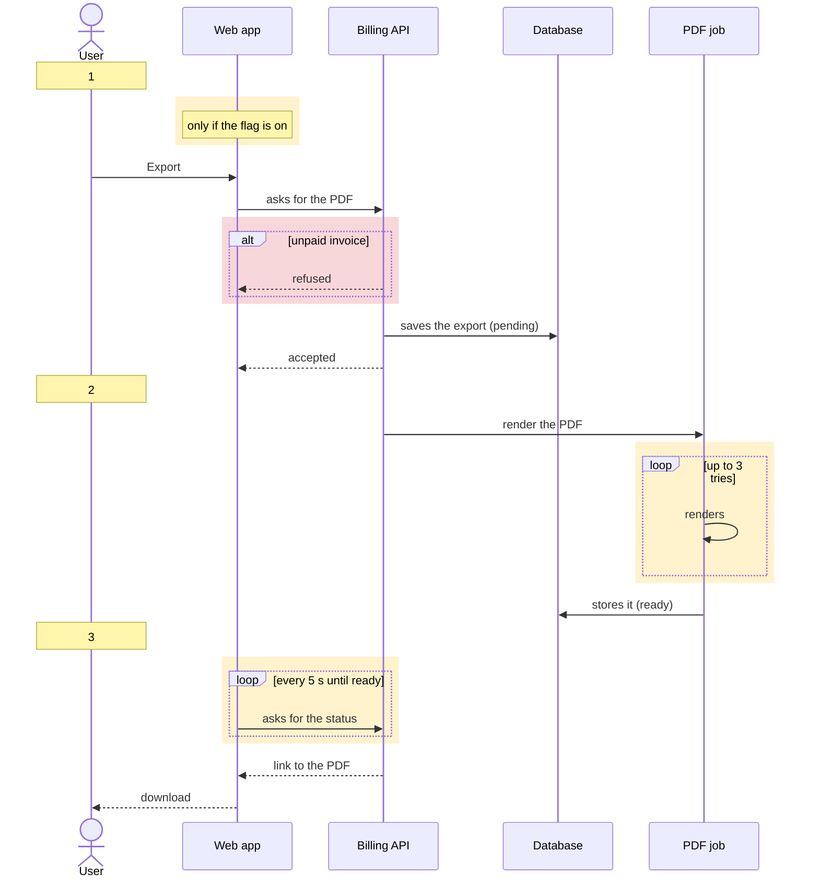
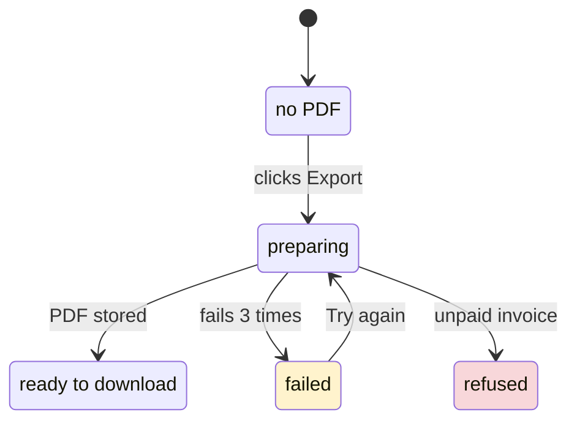

# Mermaid Rendering

Only for a destination that renders Mermaid (a PR or issue body, repository docs, an artifact). The drawing keeps the shape and rules of the terminal one: the same columns, the same product-term labels in the user's session language, the same steps, and color only on detours.

## 1. Swimlanes as a Sequence Diagram

- One `participant` per column, declared in the terminal order; the person acting is an `actor`.
- Steps: a `Note over` the first column carrying the step number, where the reader's moment starts.
- A stop: an `alt` branch inside a red `rect`. A retry, a wait, or a flag: a `loop`, `opt`, or `Note` inside a yellow `rect`. Nothing else is colored.

## 2. States as a State Diagram

- One state per state the user sees, named as the user sees it; transitions carry what moves the state.
- A state the flow ends in gets the `stop` class; a state that retries or waits gets `detour`.

## Success Validation

- [ ] The Mermaid drawing has the same columns, labels, and steps as the terminal one would, in the user's session language.
- [ ] Only stops (red) and retries, waits, or flags (yellow) are colored.
- [ ] No method, class, file, endpoint, or table name appears.
