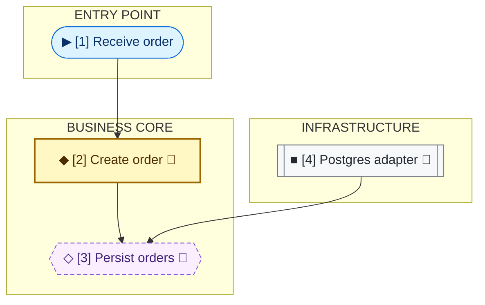

# Module Map: Grouped Responsibilities

The map answers who depends on whom in code. It does not show execution order. Use friendly labels and stable IDs in the map, then an index of exact code names. Interfaces and methods remain in separate cards.

## 1. Terminal-Native

```
▶ entry · ◆ business rule · ◇ contract · ■ infrastructure
→ depends on in code · + new · ~ modified

ENTRY POINT
┌──────────────────────────────┐
│ ▶ [1] Receive order          │
└──────────────┬───────────────┘
               ↓
╔═ BUSINESS CORE ══════════════╗
║ ◆ [2] Create order       ~   ║
║              │               ║
║              ↓               ║
║ ◇ [3] Persist orders     ~   ║
╚══════════════▲═══════════════╝
               │
┌──────────────┴───────────────┐
│ ■ [4] Postgres adapter   ~   │
└──────────────────────────────┘
INFRASTRUCTURE
MODULE INDEX
[1] OrderController
[2] CreateOrder
[3] OrderRepository
[4] PostgresOrderRepository
```

Read `A → B` as "A depends on B in code". The adapter points up toward the contract owned by the business core; the business rule does not depend on Postgres. Use a sequence diagram when the question concerns runtime calls.

Keep lines within 80 columns. Use single-column map change markers, and align borders using displayed character widths. Double borders identify the core boundary rather than another component. Adapt responsibility groups to the actual system; do not impose ports-and-adapters on unrelated architectures.

## 2. Mermaid

Use subgraphs for responsibility boundaries and preserve the same IDs and index as the terminal view. Position is a layout aid; arrowheads determine dependency direction.



▶ entry · ◆ business rule · ◇ contract · ■ infrastructure · arrow = depends on in code · 🔧 modified

**Module index**

- [1] `OrderController`
- [2] `CreateOrder`
- [3] `OrderRepository`
- [4] `PostgresOrderRepository`

The adapter and business rule both depend on the persistence contract. The group boundary separates business-owned responsibilities from technology choices.

Keep node shapes and `classDef` styles consistent: stadium for entry points, bold rectangle for business rules, dashed hexagon for contracts, and subroutine for infrastructure. Translate friendly names, responsibility labels, index headings, and legend into the reader's language; preserve code identifiers.

## 3. Deviations and Limits

- Keep at most seven primary component boxes per view; boundaries do not count as components. Split larger maps into an overview and focused views, keeping IDs stable.
- Arrows have one meaning: depends on. Do not label them with method calls, payloads, or `implements`.
- An actual architectural deviation may have a label of at most five words, using `!` in terminal maps or ⚠️ in Mermaid. Explain the consequence in the paragraph below the map. In Mermaid, style the deviation edge and check its zero-based `linkStyle` index after editing edges.
- Do not place signatures, generic types, file paths, or stereotypes inside map nodes. Use the index for code names and cards for methods.

## 4. Validation

- [ ] Responsibility boundaries reflect the actual architecture.
- [ ] All components have stable IDs and exact code names in the index.
- [ ] Arrowheads, legend, and explanation consistently mean code dependency.
- [ ] Infrastructure depends on its owned contract; any deviation is identified.
- [ ] Terminal and Mermaid express the same components and edges.
