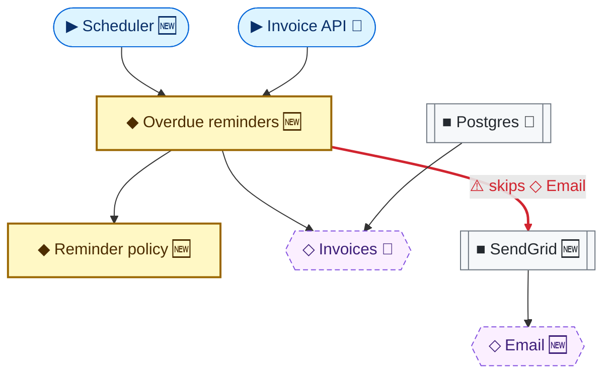

# Module Map: Examples

> Reference examples for the module map rules in [`../SKILL.md`](../SKILL.md) (Section 2). Both examples draw the same change: a feature that sends reminders for overdue invoices, with one deliberate deviation (the business rule calls the email provider directly instead of the `Email` contract it owns).

---

## 1. Terminal-Native

```
▶ entry   ◆ business rule   ◇ contract   ■ infra   → depends on
+ new   ~ modified   ! deviation

   ┌─────────────────┐   ┌─────────────────┐
   │ ▶ Scheduler   + │   │ ▶ Invoice API ~ │
   └────────┬────────┘   └────────┬────────┘
            └──────────┬──────────┘
                       ▼
          ┌─────────────────────────┐        ┌─────────────────────────┐
          │ ◆ Overdue reminders   + │───────→│ ◆ Reminder policy     + │
          └───┬─────────────────┬───┘        └─────────────────────────┘
              │                 │
              ▼                 ▼ ! skips ◇ Email
      ┌───────────────┐ ┌───────────────┐     ┌───────────────┐
      │ ◇ Invoices  ~ │ │ ■ SendGrid  + │────→│ ◇ Email     + │
      └───────▲───────┘ └───────────────┘     └───────────────┘
              │
      ┌───────┴───────┐
      │ ■ Postgres  ~ │
      └───────────────┘
```

Accompanying paragraph: *Overdue reminders is the new center of the flow. It calls SendGrid directly (!) instead of depending on the Email contract, so the business rule now knows about a vendor.*

Layout tips:
- Put the legend in the code block's first lines so it travels with the diagram.
- Place change markers at the right edge of each box, so names stay left-aligned and scannable.
- Draw infrastructure below the contracts it implements, arrow pointing up: correct dependency direction then reads as "everything points toward the business rules".

---

## 2. Mermaid

The type is encoded three ways so it survives any rendering: symbol, node shape, and style.

| Type | Shape | Mermaid syntax |
| :--- | :--- | :--- |
| `▶` Entry point | Stadium | `id(["▶ Name"])` |
| `◆` Business rule | Rectangle, bold border | `id["◆ Name"]` |
| `◇` Contract / port | Hexagon, dashed border | `id{{"◇ Name"}}` |
| `■` Infrastructure | Subroutine | `id[["■ Name"]]` |



Follow the diagram with a one-line legend in Markdown:

```markdown
▶ entry · ◆ business rule · ◇ contract · ■ infra · arrow = depends on · 🆕 new · 🔧 modified · ⚠️ deviation
```

Notes:
- `linkStyle` takes the zero-based index of the edge in declaration order; count edges after editing.
- Keep `classDef` lines identical across diagrams so readers learn the colors once.

---

## 3. Anti-Patterns

| Anti-pattern | Why it hurts | Instead |
| :--- | :--- | :--- |
| Method calls on arrows (`execute({ asOf })`) | Duplicates the interface and doubles the text to read | Unlabeled arrow; method on the card |
| File paths or stereotypes inside boxes | Noise the reviewer does not need to judge architecture | Code name on the card; paths stay in the diff |
| `implements` edges in a separate style | Two arrow semantics to decode | One semantics: the adapter depends on the contract |
| Emojis inside terminal boxes | Two-column glyphs break the box borders | One-column markers `+ ~ − !` |
| More than 7 boxes | Nothing stands out | Split into an overview and a zoom-in |
